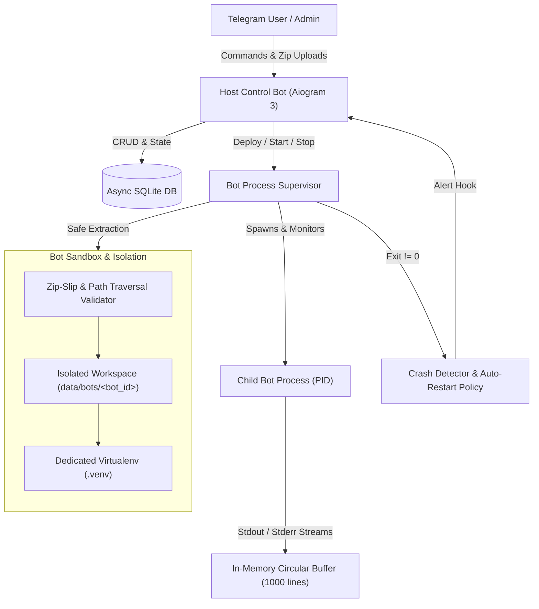

# Telegram Bot Hosting on Bot (tg-bot-hosting-on-bot)

A scalable, asynchronous platform that allows users to deploy, run, supervise, and monitor their custom Telegram bots directly through a Telegram host management interface.

---

## Architectural Overview

The platform is designed around asynchronous process orchestration, secure sandboxing, and real-time streaming supervision.



### Core Architecture Components

1. **Host Control Interface (`src/bot/` - Phase 2)**:
   - Aiogram 3-based management bot providing conversational menus, bot upload flows, live logs view, and admin controls.

2. **Process Supervisor Engine (`src/core/supervisor.py`)**:
   - Spawns independent Python child processes using non-blocking `asyncio.subprocess`.
   - Asynchronously streams child `stdout` and `stderr` lines into per-bot in-memory circular ring buffers (`collections.deque`).
   - Watches child process lifecycle; detects crashes (non-zero exits) and triggers configurable auto-restart policies with exponential cooldown and retry limits.
   - Dispatches crash notification callbacks to alerting channels.
   - Clean shutdown with full process tree termination using `psutil`.

3. **Workspace Sandbox & Isolation (`src/core/sandbox.py`)**:
   - Each hosted bot operates in its own isolated directory under `data/bots/<bot_id>/`.
   - Automated creation of private Python virtual environments (`.venv`).
   - Asynchronous dependency installation via `pip install` with configurable timeout safeguards.
   - Security-hardened archive extraction protecting against Zip-Slip, path traversal, symbolic link escapes, and malicious paths.

4. **Persistence Layer (`src/core/database.py`)**:
   - Asynchronous SQLite storage via SQLAlchemy 2.0 and `aiosqlite`.
   - Models:
     - `User`: Telegram user metadata, permission flags (`is_admin`), and configurable quota (`max_bots`).
     - `HostedBot`: Bot instance record, runtime configuration, entry point, process state (`STOPPED`, `STARTING`, `RUNNING`, `CRASHED`, `ERROR`), PID, restart counter, and custom environment variables.
     - `BotLogEntry`: Persisted event and audit log storage.

---

## Directory Layout

```
tg-bot-hosting-on-bot/
├── .env.example              # Sample environment configuration
├── .gitignore                # Git exclusions (venvs, databases, logs, sandboxes)
├── requirements.txt          # Python project dependencies
├── README.md                 # Project architecture and developer guide
├── data/
│   └── bots/                 # Sandboxed per-bot workspaces (data/bots/<bot_id>/)
├── logs/                     # Application and execution logs
├── uploads/                  # Temporary archive upload staging
├── src/
│   ├── __init__.py
│   └── core/
│       ├── __init__.py       # Core package exports
│       ├── config.py         # Pydantic Settings and environment validation
│       ├── database.py       # Async SQLAlchemy models and CRUD helpers
│       ├── sandbox.py        # Workspace sandbox, venv manager, safe zip extraction
│       └── supervisor.py     # Subprocess supervisor, stream reader, crash detector
└── tests/
    ├── __init__.py
    ├── conftest.py           # Shared test fixtures and temporary DB configuration
    ├── test_config.py        # Settings validation test suite
    ├── test_database.py      # Database models and CRUD queries test suite
    ├── test_sandbox.py       # Workspace isolation and Zip-Slip security tests
    └── test_supervisor.py    # Subprocess execution, streaming, and crash tests
```

---

## Installation & Setup

### Prerequisites

- Python 3.10+ (Python 3.11, 3.12, 3.13 fully supported)
- Git

### 1. Clone Repository & Setup Virtual Environment

```bash
# Clone the repository
git clone https://github.com/your-username/tg-bot-hosting-on-bot.git
cd tg-bot-hosting-on-bot

# Create and activate virtual environment
python -m venv .venv

# On Linux / macOS:
source .venv/bin/activate

# On Windows (PowerShell):
.venv\Scripts\Activate.ps1
```

### 2. Install Dependencies

```bash
pip install --upgrade pip
pip install -r requirements.txt
```

### 3. Configure Environment

Copy `.env.example` to `.env` and configure your settings:

```bash
cp .env.example .env
```

Key environment options:

| Variable | Description | Default |
|---|---|---|
| `BOT_TOKEN` | Telegram Bot API token from @BotFather | `""` |
| `ADMIN_IDS` | Comma-separated list of Telegram admin user IDs | `""` |
| `WORKSPACE_ROOT` | Relative or absolute path to bot workspaces | `data/bots` |
| `MAX_BOTS_PER_USER` | Maximum hosted bots per non-admin user | `3` |
| `LOG_BUFFER_SIZE` | Circular ring buffer capacity (lines) per bot | `1000` |
| `DEFAULT_RESTART_RETRIES` | Max auto-restarts before CRASHED status | `3` |
| `RESTART_DELAY_SECONDS` | Delay before attempting auto-restart | `3.0` |
| `PROCESS_STOP_TIMEOUT` | Grace period (seconds) before forceful kill | `5.0` |
| `DATABASE_URL` | Async SQLite connection string | `sqlite+aiosqlite:///data/hosting.db` |

---

## Running the Automated Test Suite

The project includes unit and integration tests covering configuration, database CRUD, sandbox isolation, zip-slip security, and process supervision:

```bash
# Run all tests
pytest -v

# Run with coverage report
pytest -v --cov=src --cov-report=term-missing
```

---

## Security Model

1. **Zip-Slip Vulnerability Prevention**:
   - `safe_extract_zip()` validates all archive paths before extracting any files.
   - Prevents absolute file paths, `..` directory traversal sequences, symbolic links pointing outside boundaries, and ensures all resolved paths reside strictly inside the designated bot workspace.

2. **Per-Bot Sandboxing**:
   - Dedicated directories per bot under `data/bots/<bot_id>/`.
   - Distinct virtual environments to prevent library conflicts and dependency poisoning.

3. **Process Tree Cleanup**:
   - When stopping a bot, `psutil` traverses and terminates all child processes spawned by the bot script, preventing orphaned background processes.

---

## Roadmap

- [x] **Phase 1: Core Engine, Database Models, and Process Sandbox Supervisor**
- [ ] **Phase 2: Telegram Management Bot (Aiogram 3 UI, handlers, menus, and bot upload flows)**
- [ ] **Phase 3: Real-Time Log Streaming via Telegram & WebSockets**
- [ ] **Phase 4: Resource Quotas, CPU/RAM Monitoring, and Advanced Admin Controls**

---

## License

MIT License.
